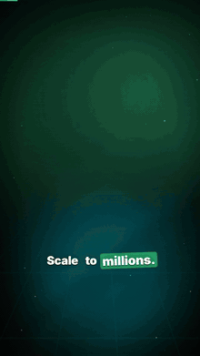

# hype-reel

**A Claude Code skill that turns any product into an insane promo reel — from its real screens, in one prompt.**

```
/hype-reel https://your-product.com
```

Claude screenshots your product with headless Chrome, finds the story (the promise, the three moments worth seeing, one honest number), writes a storyboard, and stages it with Framer Motion: the device flies in from deep 3D and the camera dives onto each feature, the UI explodes into floating layers, the camera flies through a corridor of your screens, a giant word filled with your product swallows the viewer… Then it renders a frame-exact **1080x1920 MP4** and a shareable page.

No After Effects. No templates you fill by hand. No API key.

## Demos

Four unofficial demos made with the skill from the products' public websites (not affiliated with these companies):

<table>
<tr>
<td align="center"><b>Supabase</b><br><a href="videos/supabase.mp4"></a><br><a href="videos/supabase.mp4">▶ MP4</a> · <a href="examples/supabase/reel.json">storyboard</a></td>
<td align="center"><b>Cal.com</b><br><a href="videos/calcom.mp4"></a><br><a href="videos/calcom.mp4">▶ MP4</a> · <a href="examples/calcom/reel.json">storyboard</a></td>
</tr>
<tr>
<td align="center"><b>Resend</b><br><a href="videos/resend.mp4"></a><br><a href="videos/resend.mp4">▶ MP4</a> · <a href="examples/resend/reel.json">storyboard</a></td>
<td align="center"><b>Linear</b><br><a href="videos/linear.mp4"></a><br><a href="videos/linear.mp4">▶ MP4</a> · <a href="examples/linear/reel.json">storyboard</a></td>
</tr>
</table>

GIFs are 12-second highlights; click one (or ▶ MP4) for the full 1080x1920 video in [`videos/`](videos).

## Install

```bash
git clone https://github.com/OutOfAmine/hype-reel ~/.claude/skills/hype-reel
cd ~/.claude/skills/hype-reel && npm install
```

Needs Node 18+, Python 3, and Chrome / Edge / Chromium installed (or `CHROME_PATH`). ffmpeg comes with `npm install`.

Then in Claude Code: `/hype-reel <url>` or just *"make a reel for my app"*.

## Real footage, your voice

- `scripts/record_site.mjs` records a real site loading and scrolling.
- `scripts/record_term.mjs` + `render_term.mjs` record a real terminal session (Claude Code included) and replay it in xterm.js to an MP4.
- `scripts/sfx.py` synthesises the sound design (whooshes, impacts, pops, keyboard clicks, shutters, risers) from the storyboard and mixes it under the voice.
- `scripts/align_words.py` times every word of your own voice-over, so captions and cuts land on the words.
- `theme.mode: "light"` for a clean paper/ink look, or the default dark one; fonts: Inter Tight, Instrument Serif, Anton, Montserrat, Unbounded.

## Scenes

| scene | what happens |
|---|---|
| `clip` | real footage: screen recordings, a terminal session, any MP4, on a tilted card or full screen |
| `slam` | words slam in with blur, RGB split, screen shake |
| `mask` | a giant word filled with your product — the camera dives through it into the real screen |
| `prompt` | a prompt types itself, the product flips out of the box in a burst |
| `screen` | browser/phone flies in, camera dolly-zooms onto each feature, cursor clicks, labels pop |
| `exploded` | the UI splits into floating 3D layers and snaps back |
| `tunnel` | the camera flies down a corridor of your screens |
| `wall` | an infinite tilted wall of screens |
| `orbit` | feature chips orbit your logo in 3D |
| `wipe` | before/after diagonal glitch wipe that swings back |
| `counter` | a real number counts up, rings + particle burst |
| `fan` | phone screens rise and fan out |
| `end` | logo spin, light sweep, CTA pill (`Comment *KEYWORD*`) |

Field-by-field reference: [references/scenes.md](references/scenes.md).

## By hand

```bash
node scripts/capture.mjs https://example.com shots --name home --rects "h1,#cta"
node scripts/capture.mjs https://example.com shots --mobile --name home-m
python scripts/build.py reel.json                       # -> reel.html (plays in any browser)
node scripts/render.mjs reel.html --stills 1,5,9        # quick PNG checks
node scripts/render.mjs reel.html reel.mp4              # frame-exact MP4, with your voice if reel.json has "audio"
```

Every animation is a pure function of time driven by a Framer Motion value, so the page you watch live and the MP4 are the same film.

## License

MIT
